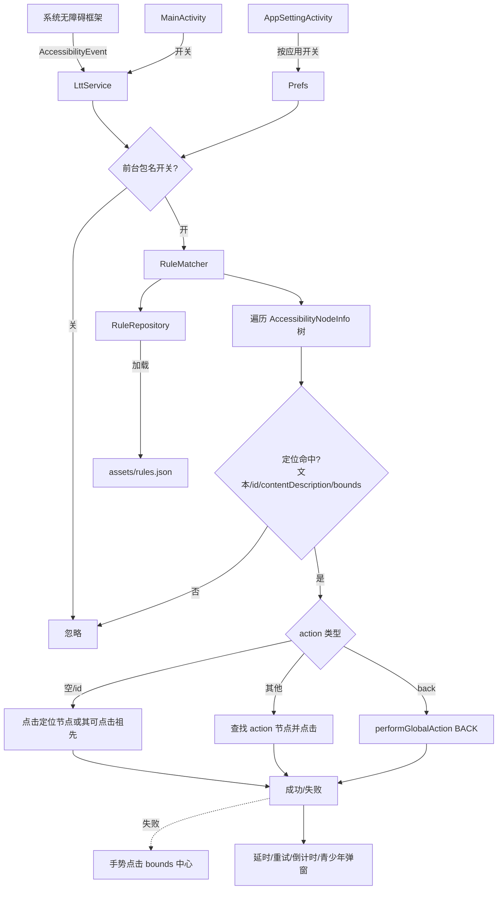

# 02 架构设计 — 李跳跳复刻（LttClone）

- 版本：v1.0
- 日期：2026-10-20
- 依据：`docs/01-requirements.md`

## 1. 技术栈选型及理由

| 项 | 选型 | 理由 |
|---|---|---|
| 语言 | Kotlin 1.9.22 | 原版为 Kotlin/Java 混合；Kotlin 简洁、空安全、与 AndroidX 契合 |
| 构建 | Gradle 8.2 + AGP 8.2.2 | 与原版 `compileSdk 33` 兼容，稳定 |
| SDK | compileSdk 34 / targetSdk 34 / minSdk 24 | compile/target 提升到 34，保持 min 与原版一致 |
| UI | AndroidX AppCompat + Material 1.11 + ConstraintLayout | 原版使用 `SwitchMaterial`、`ConstraintLayout` |
| 列表 | RecyclerView | 应用开关页 / 规则页 |
| 数据 | assets JSON + SharedPreferences | 无数据库需求；规则只读 + 用户自定义少量配置 |
| 无障碍 | `AccessibilityService` + `dispatchGesture` | 与原版一致，无需 root |
| 架构 | 单 Activity 多页面 + Service 单例 | 规模小；避免过度分层 |

不引入的依赖：网络库（OkHttp/Retrofit）、数据库（Room）、DI（Hilt/Koin），因无对应需求，保持最小依赖面。

## 2. 系统架构



## 3. 规则数据模型

### 3.1 原始规则（规则仓库）

- `BasicRules.json` / `AllRules.json`：**顶层是 JSON 数组**（不是含 `list` 键的对象），元素为**单键 dict**，键是 App 数字 id 字符串，值是 **JSON 字符串**，解析后形如：
  ```json
  {"popup_rules":[{"id":"cancel_update","action":"cancel_update"}]}
  ```
- 可选字段：`click_way_popup`、`unite_popup_rules`（`AllRules`）、`ltt_service`（`AllRules`）、`search_times_popup`、`times`（单条规则或顶层）、`delay_popup`（顶层）。
- 内层既可能是 dict、也可能是 list → 解析器需双兼容。
- 已知坏数据（尾随逗号，`Illegal trailing comma before end of array`）：
  - `BasicRules.json`：`-1031558479`(char 108)、`-1667428321`(char 117)、`-612834190`(char 49)、`1994036591`(char 46)
  - `AllRules.json`：同上 4 个 app id
  - `ExtendedRules.json`：整文件 1 处（char 675），含 3 条规则 `-1854575849`、`-1665025453`、`650999717`
  - → 修复尾随逗号后再解析，**不得丢弃**。

统计（实测）：`BasicRules` 顶层 326（322 dict + 4 坏串），`AllRules` 顶层 328（324 dict + 4 坏串），`ExtendedRules` 3 条。

### 3.2 转换后规则（应用内）

`assets/rules.json`：

```json
{
  "version": 1,
  "generatedAt": "2026-10-20T00:00:00Z",
  "apps": {
    "-1835777899": {
      "popupRules": [{"id": "青少年模式", "action": "我知道了"}],
      "clickWayPopup": true,
      "times": 3,
      "delayPopup": 1000
    }
  }
}
```

- `apps` 键 = App 数字 id 字符串。
- `popupRules` = 合并去重后的 `(id, action)` 列表。
- 可选 `clickWayPopup` / `times` / `delayPopup` / `unitePopupRules` / `lttService`。

### 3.3 内存模型（Kotlin）

```kotlin
data class Rule(val id: String, val action: String)
data class AppRules(
    val popupRules: List<Rule>,
    val clickWayPopup: Boolean = false,
    val times: Int = 1,
    val delayPopup: Long = 0L,
    val unitePopupRules: List<Rule> = emptyList()
)
```

## 4. 规则转换流水线（`tools/convert_rules.py`）

```
读取 BasicRules/AllRules/ExtendedRules
  → 去除尾随逗号（正则 `,(\s*[\]}])` → `\1`）
  → json.loads（顶层数组）
  → 逐元素：单键 dict，键=appId，值=JSON 字符串（再次 json.loads，dict/list 双兼容）
  → 归并：All 为基线 → Extended 补充 → Basic 仅补新 (id,action)
  → 输出 apps 映射 + version/generatedAt
  → 打印统计：app 数、规则对总数、坏串修复数
```

关键点：
- 顶层直接迭代数组（不可用 `d["list"]`）。
- 内层值字符串需二次 `json.loads`，并用尾随逗号修复兜底。
- 若同一 app 既在 `popup_rules` 又在 `unite_popup_rules`，两者都保留（`unitePopupRules` 单列）。
- 输出 UTF-8、`ensure_ascii=False`、缩进 2。

## 5. 匹配算法（`RuleMatcher` + `NodeMatcher` + `SplashSkipper`）

采用**会话式扫描**：一次前台窗口事件触发后开一个会话，会话内按固定间隔多轮扫描，避免广告控件渲染晚于事件而被漏掉。

1. **会话调度**
   - 会话内每 250ms 扫描一轮，最多 24 轮（6s）；连续 8 轮无动作则提前结束（2s）。
   - 会话进行中的新事件**不再丢弃**，记为 `pendingPackage`，会话结束后延迟 100ms 续跑。
2. **定位（`NodeMatcher`）**
   - `id` / `action` 均按上游语义用 `&` 拆分为 OR 候选（上游格式「关键字(或控件ID)&关键字」）。
   - 每个候选在节点树中打分，取**最高分**节点，而非首个 `contains` 命中：
     - 文本完全相等 100 / 前缀 80 / 包含 60；
     - `viewIdResourceName` 以 `/key` 结尾 95、包含 85；
     - 四段 `l,r,t,b` bounds 精确匹配 100（容差 12px）。
   - 节点树 BFS 遍历上限 3000 个节点。
3. **动作（`perform`）**
   - `action` 为空或等于 `id` → 点击已定位节点；
   - `action` 为 `back` / `GLOBAL_ACTION_BACK` → `performGlobalAction(GLOBAL_ACTION_BACK)`；
   - `action` 为 `x:123y:456` → 按坐标派发手势；
   - 否则在树中独立定位 `action` 对应节点并点击。
4. **点击策略**
   - 节点自身 `ACTION_CLICK` → 可点击祖先 `ACTION_CLICK` → `dispatchGesture` 点中心点；
   - 两种方式可切换：点击后 700ms 回检节点是否仍存在，未消失说明未生效，切换方式重试，最多切 2 次。
5. **通用开屏跳过（`SplashSkipper`）**
   - 上游规则库以应用内弹窗为主，开屏规则极少，故补充通用启发式：
     - 严格文案正则（长度 ≤ 8）：`跳过` / `跳过广告` / `点击跳过` / `Skip` / `Skip Ad` / `跳过 5` / `5s跳过` / `关闭广告`；
     - 宽松包含（仅当节点可点击）：`跳过` / `skip` / `关闭广告`；
     - 控件 id 含 `skip` 或含 `splash` 且含 `ad`/`btn`。
   - 安全约束：控件面积不超过屏幕 1/4；可点击优先（可点击得分 +25）；不可点击时要求位于屏幕上半部。
   - 生效窗口：应用切到前台后的 15s 内，且每次前台切换只触发一次。
6. **高级参数**：`times`（失败重试，间隔 200ms）、`delayPopup`（命中后延迟执行）、`clickWayPopup`（强制手势点击）、`searchTimesPopup`（未命中时的重扫轮数）。

## 6. 组件设计

| 组件 | 职责 |
|---|---|
| `App` | Application，初始化 Prefs / Repository |
| `MainActivity` | 无障碍服务状态、通用跳过开关、规则库统计、未开启时弹出引导、`SwitchMaterial` |
| `AppSettingActivity` | 按应用开关列表（RecyclerView）+ 规则明细弹窗 |
| `service/LttService` | 无障碍服务；事件入口；前台包名与「开屏窗口期」管理；`Log.i` 关键日志 |
| `service/RuleMatcher` | 会话式调度、动作派发、效果验证与点击方式切换 |
| `service/NodeMatcher` | 节点定位：OR 拆分、打分择优、bounds / 坐标解析、节点树遍历 |
| `service/SplashSkipper` | 通用开屏广告按钮启发式识别 |
| `data/Rule` | 数据类 |
| `data/RuleRepository` | 加载 assets/rules.json + 缓存 |
| `data/Prefs` | SharedPreferences 封装（总开关、按应用开关、通用跳过开关） |

## 7. 错误处理与日志策略

- 规则加载失败：捕获异常，使用空规则集，`Log.e` 记录，UI 提示。
- 单条规则异常：跳过该条，计数，不影响其他。
- 节点遍历异常：捕获 `IllegalStateException`（节点已失效），跳过。
- 手势/点击失败：静默降级，按 `times` 重试；点击后回检仍未生效则切换点击方式重试。
- 日志：TAG 统一为 `LttService`，关键节点用 `Log.i`（`service connected` / `acted key=… method=…`），便于真机 `adb logcat -s LttService` 排查；不落盘、不上传。
- 不使用崩溃上报 SDK。

## 8. 安全设计

- **无网络**：Manifest 不声明 `INTERNET`/`ACCESS_NETWORK_STATE`。
- **最小权限**：仅 `QUERY_ALL_PACKAGES`、`BIND_ACCESSIBILITY_SERVICE`。
- **数据本地化**：所有状态存 SharedPreferences，不外发。
- **无障碍范围**：仅读取窗口内容用于定位，不采集文本内容归档。
- **导出规则**：`allowBackup=false`（复刻版收紧，减少数据外泄面）。
- **无动态加载**：不加载外部 dex/so，不放宽网络安全配置。

## 9. 构建与分发

- 标准 Gradle 工程（`settings.gradle.kts` + root/app `build.gradle.kts`），含完整 `gradlew` + `gradle-wrapper.jar`。
- 需自备 Android SDK（`local.properties` 或 `ANDROID_HOME`）：Platform 34 + Build-Tools 34.0.0。
- 规则文件随 APK 打包（`app/src/main/assets/rules.json`）。
- 分发须遵守 AGPL-3.0（规则库许可）。
- 已验证：`./gradlew assembleDebug` 构建成功，`./gradlew lintDebug` 0 errors / 0 warnings。
